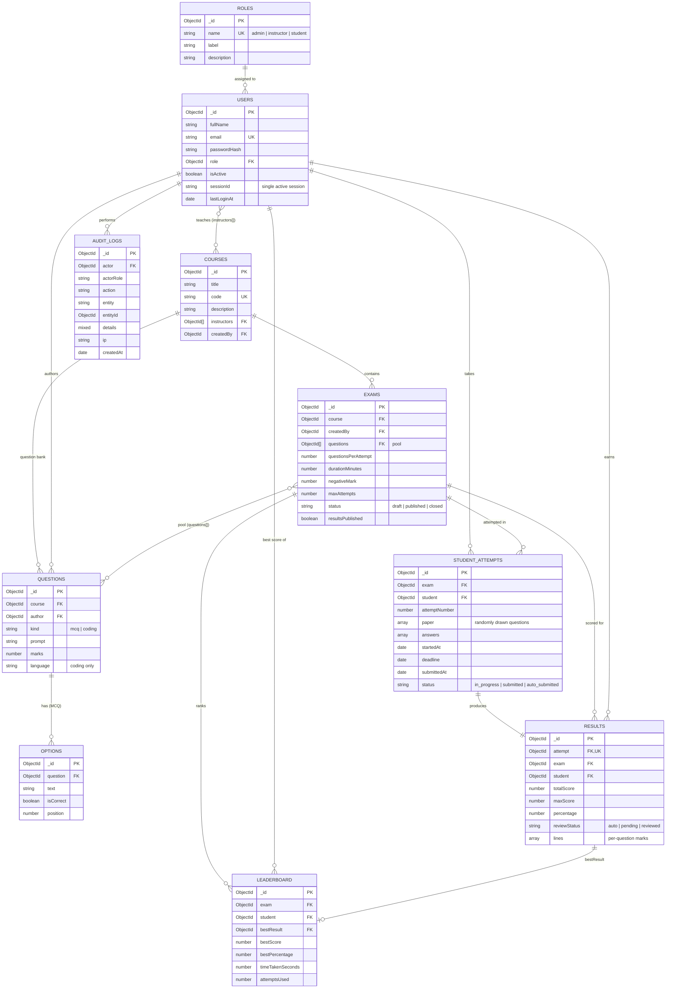

# ER Diagram

GitHub draws the Mermaid diagram below automatically. You can also paste it into <https://mermaid.live> to view or export it.

## Reading the diagram

- An **instructor** is linked to courses through `courses.instructors`. They can only manage questions and exams of those courses.
- An **exam** holds a *pool* of questions. Each **attempt** draws `questionsPerAttempt` of them at random and stores that paper, so a reload shows the same paper.
- Each finished attempt has exactly **one result**. The **leaderboard** keeps one row per (exam, student), pointing at that student's best result.
